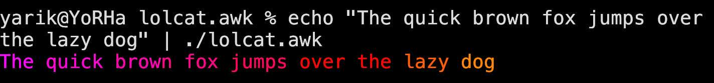

# lolcat.awk



lolcat colors terminal text like a rainbow. Runs on any box that already has `awk`.

Needs a 256-colour terminal and an `awk` that splits `FS = ""` per character (`gawk`, `mawk`, busybox `awk` all do).

## Install

```sh
$ cp lolcat.awk ~/.local/bin/lolcat && chmod 755 ~/.local/bin/lolcat
```

> make sure that `~/.local/bin/lolcat` is in `$PATH`

## Usage

```sh
$ lolcat.awk <file>
$ date | lolcat.awk
```

## Environment

| Variable     | Default    | Meaning                                                        |
| ------------ | ---------- | -------------------------------------------------------------- |
| `START`      | random     | Starting hue in degrees. `0` red, `120` green, `240` blue.     |
| `SHIFT`      | `360`      | How far the hue rotates across a line. `720` wraps twice.      |
| `NCOLORS`    | line-sized | Size of the colour table. Small values give chunky bands.      |
| `SATURATION` | `1.0`      | `0.0` grey - `1.0` vivid.                                      |
| `VALUE`      | `1.0`      | `0.0` black - `1.0` bright.                                    |
| `SEED`       | unseeded   | Seed the random starting hue. Can be set to `$RANDOM` in Bash. |

## How it works

`FS = RS = ""` gives paragraph records of one-character fields, and the loop prints each field with its own colour prefix; newline fields keep the layout. The colour table is sized from the first line at about 4.3 colours per character, so the hue travels roughly `360 / length` per character and short and long lines both get a full sweep. HSV to RGB to an index in the 6x6x6 colour cube. Escape sequences already in the input pass through uncoloured, so there is no concern to sanitize it.

Sizing from the first line is a known constraint: a file that starts short and grows much longer shades slowly on the long lines, so set `NCOLORS` yourself. Also, most versions of `awk` count bytes rather than characters, so CJK characters and emoji can cause the output to wrap sooner than expected. A simple fix is to use `wcwidth` or `wcswidth` instead of `length()` to measure each character's terminal display width.

## License

MIT, see [LICENSE](LICENSE).
